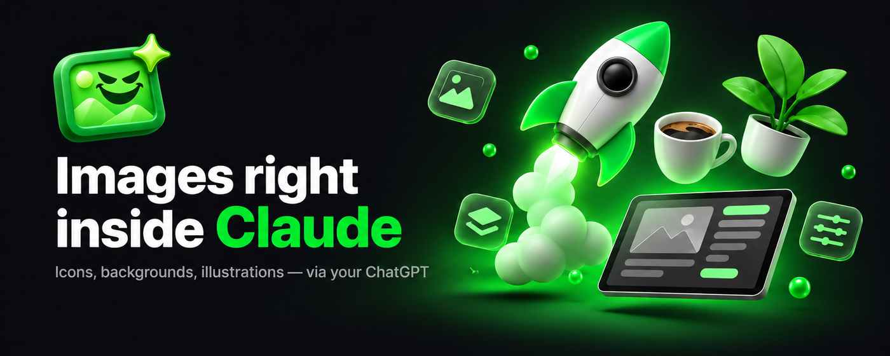
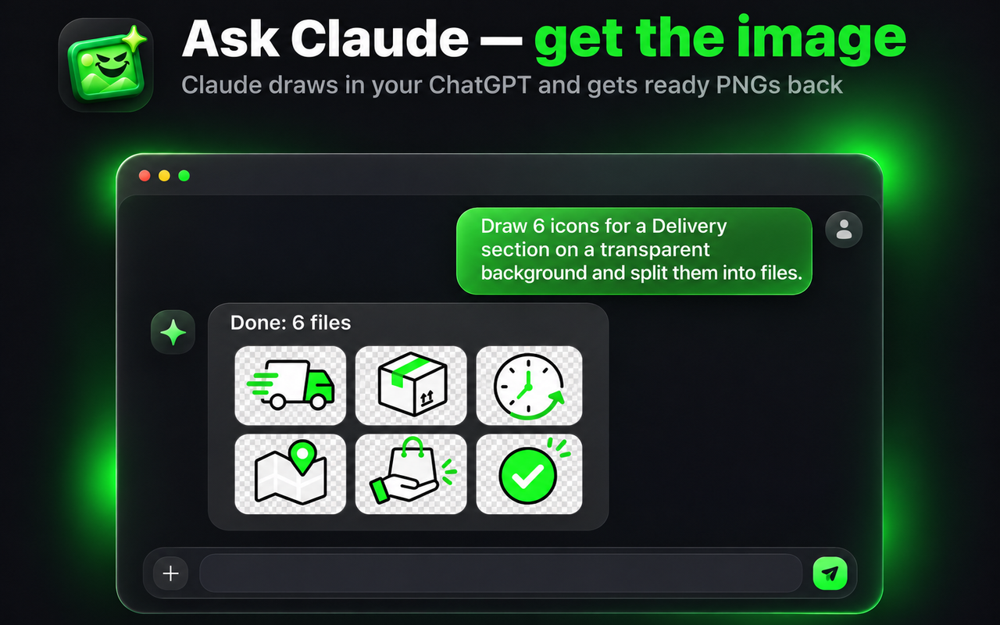
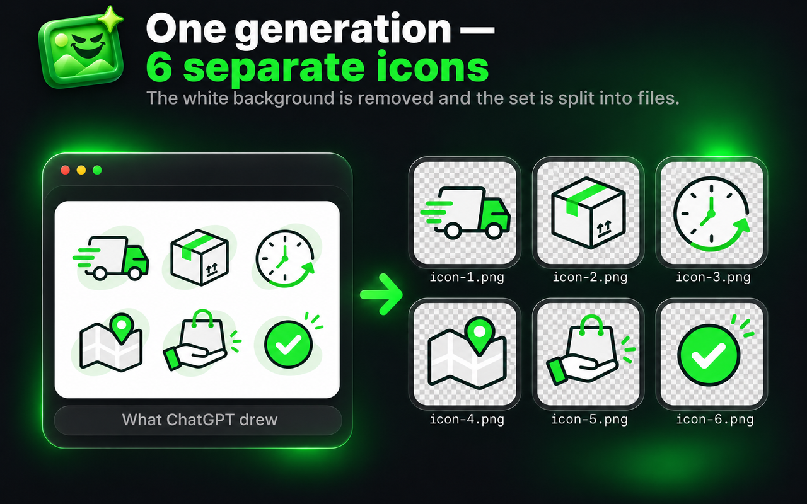
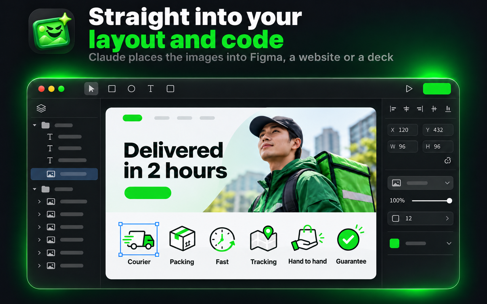
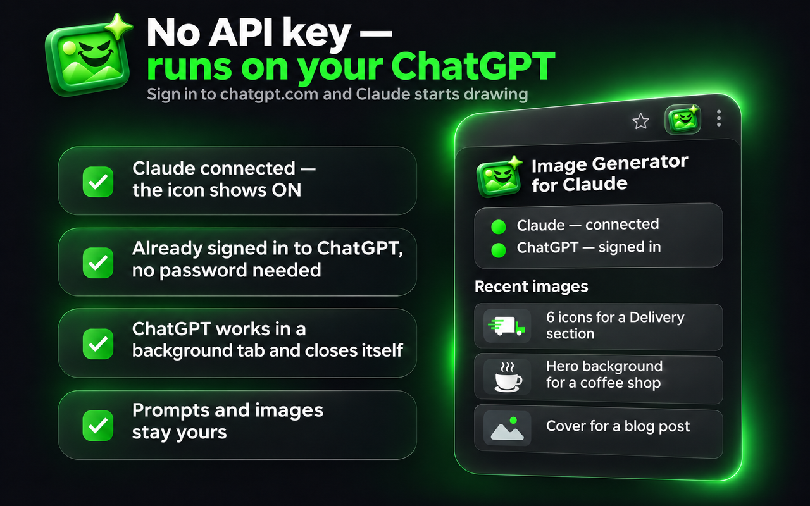
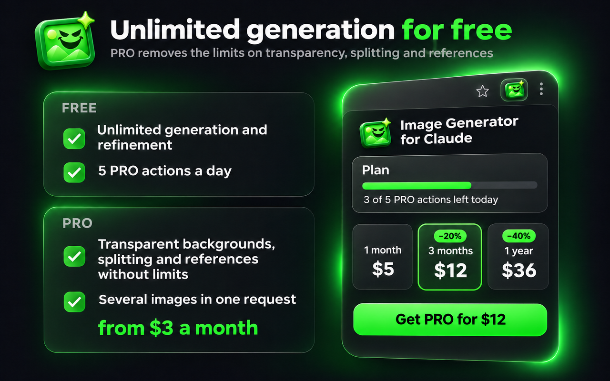

<p align="center">
  <a href="https://tentek.pro/claude-image"></a>
</p>

<h1 align="center">Image Generator for Claude</h1>

<p align="center">
  <b>An MCP server that gives Claude image generation — through your own ChatGPT.</b><br>
  Icons on transparent backgrounds, hero images, illustrations and Figma assets, straight into your Claude workflow. No API key.
</p>

<p align="center">
  <a href="https://tentek.pro/claude-image"><b>Website</b></a> ·
  <a href="https://github.com/kaicex/tentek-image-releases/releases/latest/download/tentek-image.mcpb"><b>Download for Claude Desktop</b></a> ·
  <a href="https://t.me/kaicex">Support</a>
</p>

<p align="center">
  <a href="https://github.com/kaicex/tentek-image-releases/releases/latest"></a>
  
</p>

---

## Why

Claude is great at building interfaces — components, Figma layouts, landing pages. But it can't generate images.
So every icon or hero background means: open ChatGPT, write the prompt, download, remove the background somewhere else,
drag the file back. Five windows for one icon.

With Image Generator you just ask Claude: **“Draw 6 matching icons for the Delivery section on a transparent background.”**
Claude sends the prompt to your own ChatGPT, waits for the image, removes the background, splits the set into separate
PNGs — and keeps working with them.

<p align="center">
  
  
</p>

## What it can do

- **Generate images from Claude** — Claude Desktop and Claude Code, any prompt ChatGPT can draw
- **Transparent backgrounds** — icons and objects without the white box, ready for any layout
- **Split icon sets** — one 3×2 generation becomes six separate PNG files
- **Refine in the same chat** — “make the background darker”, “add a soft shadow”
- **Style from a reference** — attach a Figma screenshot and the image follows its look
- **Batch generation** — several different images in one request (PRO)
- **Cheap previews for Claude** — a small preview is saved next to every image, so Claude spends fewer tokens looking at it

<p align="center">
  
  
</p>

## How it works

```
Claude
  │  MCP
  ▼
Image Generator server — on your computer
  │  localhost
  ▼
browser extension — a background ChatGPT tab
  │
  ▼
your ChatGPT account → PNG back to Claude
```

- **The server** runs locally and gives Claude the tools `generate_image`, `generate_batch`, `list_chats`, `status`.
- **The extension** (Chrome and Chromium browsers) opens ChatGPT in a background tab, types the prompt, waits for the image and closes the tab.
- **Your data stays yours**: prompts and images go only to your ChatGPT and your computer.

## Install

**1. Connect the server to Claude**

- **Claude Desktop** — download [tentek-image.mcpb](https://github.com/kaicex/tentek-image-releases/releases/latest/download/tentek-image.mcpb)
  and double-click it. Claude Desktop installs it for you.
- **Claude Code** — an npm package for `npx` is coming soon.

**2. Install the “Image Generator for Claude” browser extension** and sign in to [chatgpt.com](https://chatgpt.com) in the same browser.
When the extension icon shows a green **ON**, you're connected.

**3. Ask Claude** — for example:
- “Draw 6 matching icons for a Delivery section on a transparent background and split them into files”
- “Make a hero background in the style of this screenshot”
- “Generate an illustration for the empty cart state and place it into my Figma layout”

Images are saved to `Pictures/Claude Images` (configurable).

## Pricing

<p align="center">
  
</p>

| | Free | PRO |
|---|---|---|
| Image generation and refinement | unlimited | unlimited |
| Transparent backgrounds, splitting, references | 5 a day | unlimited |
| Batch generation | — | ✓ |
| Price | $0 | $5 / month · $12 / 3 months · $36 / year |

Generations themselves run on your ChatGPT subscription — there is no per-image cost.

## FAQ

**Do I need an OpenAI API key?**
No. Images are made in your ChatGPT account, just as if you did it by hand.

**Does it work on claude.ai in the browser?**
No. It needs Claude Desktop or Claude Code — only they can connect a local MCP server.

**Which ChatGPT plan do I need?**
Any plan that can generate images in chatgpt.com.

**Where do my prompts and images go?**
Only to your own ChatGPT and your computer. Nothing is sent to our servers.

**Why does a ChatGPT tab appear for a minute?**
The extension opens it in the background for the generation and closes it afterwards.

**Is it against OpenAI's terms?**
OpenAI's terms restrict automating the ChatGPT website. The extension works at a normal human pace, but the risk stays with you — don't generate hundreds of images in a row.

**Does it work with other MCP clients?**
It's a standard MCP server, so any MCP client that can run a local stdio server should work. Tested with Claude Desktop and Claude Code.

## About this repository

This repository holds the ready-to-install builds (`.mcpb` for Claude Desktop). Version history is in
[Releases](https://github.com/kaicex/tentek-image-releases/releases). Privacy policy:
[kaicex.notion.site/…](https://kaicex.notion.site/423387433623815999acef68920b3f90).

---

<sub>Image Generator for Claude is an independent project by Tentek. It is not affiliated with Anthropic or OpenAI and is not
their official product. Claude and ChatGPT are trademarks of their respective owners. Images are generated only in your own
ChatGPT account and only on your command.</sub>

<!-- Keywords: Claude image generation, Claude MCP image generator, generate images in Claude, Claude Desktop image MCP, Claude Code images, ChatGPT image generation MCP, transparent PNG icons AI, Figma AI icons, gpt-image without API key -->
